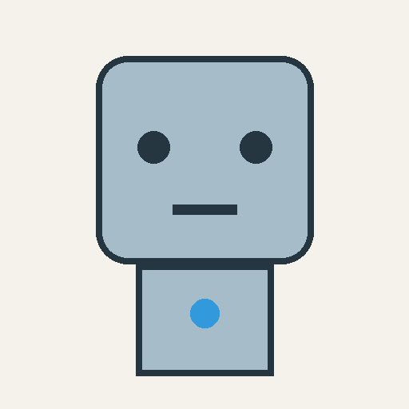
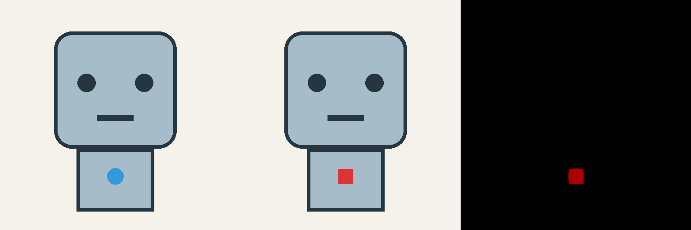

# Local Design Editor

既存デザインの指定部分だけを編集する、ローカル実行のCLIです。**指定外の画素を原画像からコピーし、RGBとAlphaの差分ゼロを検証します。** CodexなどのコーディングエージェントからJSONで操作できます。



## Phase 1

| 操作 | 実装 |
| --- | --- |
| Extract | 原画素の矩形切り抜きと任意の透過マスク。隠れた部分は補完しない |
| Recolor | OpenCVの色相変更。彩度・明度とAlphaを保持する設計。RGB変換の丸めは生じる |
| Geometry | 平坦色の範囲を明示して矩形へ置換。形・色・中心位置を決定論的に指定 |
| Mask | 矩形・多角形、編集可能・保護・参照マスク、内側フェザー |
| Inpaint / Redesign | ローカルComfyUIのSD1.5 Inpaintingワークフロー |
| Composite | 候補画像を許可領域内だけ原画像へ合成 |
| Verify | 保護領域のRGBA完全一致、解像度、変更画素数、差分画像 |
| Evaluate / Review | 指定形状の塗り・周囲・Alpha等の独立検査と、結果ハッシュに対応する目視評価記録 |
| History | 実行ごとの不変な原画像コピー、SHA256、設定、結果、失敗理由 |

マスク内の品質や指示の達成は自動保証しません。`pixel_preservation_pass`と`intent_review`を分け、画素保持に合格しても`overall_status`は`needs_visual_review`です。空マスクや解像度の不一致はエラーにします。PNG出力のみを使用します。

## 起動

Python 3.11以上。GPUなしでも切り抜き・色変更・合成・テストは動作します。

```sh
python -m venv .venv
# Windows: .venv\Scripts\activate
# macOS/Linux: source .venv/bin/activate
python -m pip install -r requirements.lock
python -m pip install --no-deps -e .
python examples/create_sample.py
design-edit run examples/recolor.json
design-edit run examples/extract.json
design-edit run examples/square.json
python -m pytest -q
```

サンプルはこのリポジトリで作成した幾何学ロボットです。「胸の丸い表示灯の色だけを変更」「表示灯を小さい四角に変更」を例にし、既存作品の素材を必要としません。



四角化は生成モデルを使わず、`geometry`で33×33画素の赤い正方形へ置き換えます。中心は元の表示灯と同じ`(256, 392)`です。対象以外のRGBA差分ゼロ、四角内部1,089画素の色一致、周囲の復元色、Alpha保持を検査し、原寸・拡大画像でも確認しています。

`geometry`は`erase_box`の平坦な背景色と`box`の矩形色を明示します。模様や陰影のある背景を推定して塗りつぶす用途には使いません。編集マスク・保護領域・フェザーによって必要な範囲が完全に編集できない場合は、形状を欠けさせて出力する代わりにエラーにします。数値で正確に定義できる形状は、形状変更でも画像処理を先に選びます。

### マスク作成

領域JSONの座標は元画像の画素座標。矩形は`[left, top, right, bottom]`で右・下端を含みません。

```json
{"boxes": [[224, 360, 289, 425]], "polygons": []}
```

```sh
design-edit mask examples/robot.png regions.json mask.png
design-edit run request.json --output runs
```

```json
{
  "mode": "recolor",
  "source": "input.png",
  "editable_mask": "mask.png",
  "protected_mask": "protected.png",
  "hue": 0,
  "feather": 2,
  "instruction": "Change only the status indicator to red",
  "protected_constraints": ["Preserve silhouette, position and other colors"]
}
```

素材パスは依頼JSONからの相対パス。保護マスクの非ゼロ領域は編集マスクより優先します。参照マスクは保存される参考情報で、生成制御には未使用です。フェザーは許可領域の内側だけに適用し、外へ広げません。パレット画像はRGBAへ正規化して比較し、EXIF回転やICC変換は自動適用しません。高ビット深度・アニメーション画像は対象外です。

## ローカルInpainting

[セットアップ](docs/comfyui.md)を参照してください。ComfyUIを`127.0.0.1:8188`で起動後：

```sh
design-edit run examples/textile.json
```

このサンプルは、指定面と表示灯だけを薄青の布地へ置き換えます。96×96画素の許可領域を512×512の作業画像へ一様拡大して生成し、元の座標へ戻します。織り目は生成作業画像で確認でき、原寸では細部が減ります。指定領域外のRGBA差分はゼロです。追加された布の折れと四角い挿入境界は、この面全体を置き換える課題の範囲です。

過去の`examples/inpaint.json`による四角化は目視評価で不合格のまま保存しています。これをモデル不足の根拠にせず、四角化の推奨操作を`examples/square.json`へ修正しました。除去編集は`examples/remove-indicator.json`で試せます。具体的な成功・失敗画像は検証記録に掲載しています。

画像・マスクをアップロードし、`/prompt`→`/history/{id}`→`/view`で結果を取得します。[ComfyUI公式API](https://docs.comfy.org/development/comfyui-server/comms_routes)に基づくコアノードのみの構成です。キャンバスは8の倍数へ右下パディングし、元サイズへ切り戻すため、座標やサイズを拡縮しません。生成候補のAlphaは原画像に戻してから合成します。

`context_box`使用時はその正方形の作業領域だけを一様拡大し、生成後に同じ範囲へ戻します。元のキャンバス・保護領域は拡縮しません。生成用入力・マスク・デコード結果も実行履歴へ保存します。

有料サービス・従量API・Photoshopは不要です。モデルの重みは同梱せず、各モデルのライセンスを別途適用します。コードのMITライセンスはモデルへ適用されません。

## 品質と履歴

各`runs/<id>/`に`request.json`、原画像、マスク、候補、結果、`comparison.png`（原画像・結果・差分の順）、`validation.json`を保存します。ComfyUI実行時は実際のワークフロー・実行履歴・環境情報も記録します。エラー時は`failure.json`を保存します。実行履歴はローカルに置き、Gitには含めません。生成の完全再現性はGPU・モデル・ComfyUIの版にも依存するため、seedだけでは保証しません。

編集の基準は採用済みの原画像です。候補を自動で次の基準へ昇格しません。形・位置・大きさ・比率・色・表情を別の変更軸として管理し、一回の編集を狭く限定します。表示サイズと拡大画像の両方でマスク内の形状・境界を確認してください。

`expectations`は候補生成に使わない独立の検査条件です。`solid_rectangle`（矩形範囲のRGB完全一致）、`patch_palette`、`unchanged_outside_box`、`alpha_unchanged`を指定でき、不合格ならCLIは終了コード2を返します。画素保持に合格しても期待条件が不合格なら成功扱いにしません。

目視確認後は、結果のSHA256を指定して別ファイルにレビューを記録できます。これは人間またはエージェントによる申告であり、自動画像認識の判定ではありません。元の検証記録を変更せず、評価ごとに追記します。自動検査に不合格の結果、無変化の編集、ハッシュが違う結果の採用は拒否します。

```sh
design-edit review runs/<id> --status accepted --reviewer <name> --note "原寸と拡大で指定形状と保持範囲を確認した具体的な所見" --result-sha256 <validation.jsonのresult_sha256>
```

## 今後の段階

Phase 1の実画像レビューを通過してから、マスク精度、パラメータ調整、ControlNet、SDXL、他のローカルモデルの順に必要性を判断します。Phase 2/3の自然言語解釈・自動検出・IoU/Hausdorff・ランドマーク・左右対称・複数視点照合・条件付き再試行・モデル比較は未実装です。無制限の自動再生成は行いません。タイムアウト時のジョブはComfyUIに残る可能性があり、記録したIDで確認します。

複数方向の将来仕様では物体自身の左右、同尺度・同投影、遮蔽と取り付け位置を記録します。2Dから検証できない奥行きは推定とし、他視点を勝手に再生成しません。新規生成は局所編集とは別操作として扱い、現CLIでは提供しません。

開発・検証状況は[検証記録](docs/validation.md)を参照してください。
