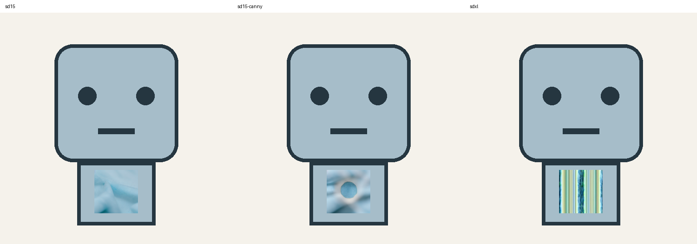
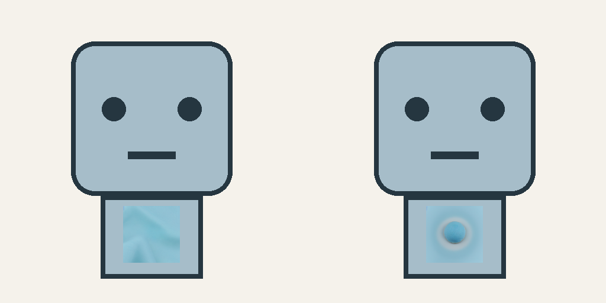

# Phase 1–3: implemented scope and acceptance

Version 0.2 implements each phase as a local, testable workflow. Completion refers to the declared supported operations and acceptance fixtures below. It does not mean arbitrary-language understanding, automatic 3-D reconstruction, or unconditional design-quality guarantees.

## Phase 1 — exact preservation

Crop/transparent extraction, masks, recolor, explicit flat geometry, local inpainting, compositing, RGBA verification, immutable run artifacts and hash-bound visual assessment are operational. The original unmet square task passed through deterministic geometry. See [the original evidence](validation.md).

## Phase 2 — quality control and model comparison

- Binary silhouette IoU, symmetric contour Hausdorff and mean distances in source pixels.
- Selector-derived landmark center, area, bounding box and aspect ratio; per-target tolerances.
- Symmetry around a pixel or half-pixel axis; declared asymmetric exclusions.
- Canny reference-to-result edge distance. Extra generated edges still need review.
- Original/result RGB jump across editable/protected adjacency, recorded as a boundary measurement rather than a semantic seamlessness verdict.
- Actual ComfyUI ControlNet Canny workflow with generation/control family compatibility checks. No custom nodes or paid endpoint.
- SD1.5 and SDXL Inpainting local loaders; architecture adapters remain interchangeable through the backend protocol. Unsupported families fail explicitly.
- Same-source/mask/instruction/seed/steps/CFG/denoise/context-resolution model comparisons, timings, sampled whole-device VRAM and model identity. The comparison runner cannot change the common prompt or sampling conditions through a profile.

### Actual RTX 5060 comparison

The final acceptance run used a 96×96 editable patch, 512×512 working crop, seed 42, 20 steps, CFG 7, denoise 1.0. ComfyUI ran with `--lowvram --disable-dynamic-vram --disable-async-offload --disable-all-custom-nodes`.

| Configuration | Observed seconds | Sampled device peak MiB | Visual outcome for cloth replacement |
| --- | ---: | ---: | --- |
| SD1.5 Inpainting | 2.41 | 3302 | Light-blue woven cloth; accepted baseline |
| SD1.5 + Canny | 3.23 | 4006 | Cloth with a retained circular feature; rejected for a task that removes that feature |
| SDXL Inpainting | 12.53 | 6534 | Striped output; rejected in this tested loader/configuration |

These are single observations including loading/caching effects, not statistically controlled speed rankings or exact process allocator peaks. The common 512px comparison is not an SDXL-native-resolution quality study. The SDXL result is a failed candidate, not evidence that SDXL is intrinsically incapable. Model revision/file hashes are recorded in [models-tested.json](models-tested.json). The old dynamic-VRAM setup was also tried; switching to conventional loading did not resolve the SDXL visual failure. No failed configuration was promoted to default.



A separate matched-condition **retain the circular motif** task demonstrated useful ControlNet behavior: without control the expected reference edges disappeared; with Canny the mean reference-edge distance was about **1.21 source pixels**, below the predeclared 2px threshold. The controlled output also has a visible halo/relief around the circle, so this is measured contour guidance, not exact shape identity. Extra details require review before use on a strict flat design.



The default remains SD1.5. FLUX, other ControlNet modalities and further model installs were not required for the accepted baseline tasks; no quality improvement is claimed for untested models.

## Phase 3 — bounded automation

`auto` interprets a small English/Japanese grammar over a user-owned catalog. It recognizes extraction, color change, approved rectangular replacement, material synthesis and pattern redesign. Target selection uses registered names/aliases; masks are detected from RGB tolerance, foreground-vs-background, Alpha, connected-component seed, or an explicit ROI/box. Per-mode selectors keep a color-only edit from accidentally selecting the surrounding panel. Unknown targets, multiple edits, unsupported qualifiers, color/preset conflicts and negation fail closed. This is deterministic instruction parsing, not an unrestricted local language model.

```sh
python -m examples.advanced_samples
design-edit auto examples/catalog.json "表示灯の色だけ赤に変更"
design-edit auto examples/catalog.json "make indicator square"
design-edit auto examples/catalog.json "extract head"
design-edit auto examples/catalog.json "surface fabric" --plan-only
design-edit batch examples/batch.json
```

`--plan-only` saves a request and detected mask for inspection. No free-text prompt is guessed for synthesis: the catalog must provide an explicit approved local model preset. Protected masks always override editable masks. The batch example applies one instruction to two independently colored designs and retains per-input failures; no result becomes the next approved source automatically.

### Conditional retries and observations

```sh
design-edit trials examples/textile.json examples/retry.json
design-edit history runs --output runs/observations.json
design-edit recipe runs/<reviewed-id> runs/recipe.json
design-edit reuse request.json runs/recipe.json
```

Retries have a hard limit of 1–8 attempts, immutable source/mask permissions, duplicate-condition suppression and cause-specific parameter allowlists. Causes distinguish zero change, insufficient change, shape drift, failed intent constraints and backend failures. A pending/timed-out backend job is never resubmitted automatically. A real GPU negative test deliberately required an impossible change count: it stopped after two distinct seeds, retained both failures and saved a best candidate. Tests also cover recovery after a no-op and refusal to expand permissions.

History is observations only. Recipe export requires a successful result and an uncontradicted, hash-matching acceptance review. Reuse requires the same source hash, operation, instruction, permission masks and evaluation conditions. Parameter reuse is explicit; algorithm/default changes never arise automatically from an observation.

### New designs and multiple views

```sh
design-edit generate examples/standard.json
design-edit generate examples/standard-alternative.json
# Place views-template.json beside the generated images, then:
design-edit views verification.json --output multiview.json --feature head
```

`generate` is distinct from editing. The geometric engine renders declared primitives/palettes into front, object-left, object-right and back views. The optional `comfy` engine synthesizes new images from a shared description and view labels; it has no automatic cross-view identity guarantee and still needs the same review/measurement gates. Neither engine claims to preserve an existing source.

The optional `examples/generate-comfy.json` transport was executed locally, but its visual result included watermark-like text and cropped feet and was **rejected**. The accepted new-design examples use the explicit geometric standards. Generation results can be reviewed with the same `review` command using the `sheet_sha256` in `generation.json`; every view hash is checked before a review is recorded. This optional failed candidate is not represented as an accepted design.

Cross-view validation measures selector-derived image points in a declared orthographic coordinate system with origin and pixels-per-unit. Front/back share X/Y; left/right share Z/Y with explicit signs. Alignments compare only axes observable in those projections. Visibility checks enforce declared present/absent features. Missing points, unknown axes and incompatible projection fail/inconclusive rather than pass. Dependencies return other-view review candidates; the validator never edits those images.

The actual geometric fixtures produced two four-view designs. Head-top and body-bottom heights matched exactly across four directions; the front-only indicator was absent in both side views and the back. Perturbed-height tests fail. Hidden surfaces, unobserved depth and semantic correspondence beyond the declared selectors remain explicitly unverified.


## Repeatable acceptance

```sh
python -m pytest -q
python -m scripts.acceptance
# After optional local comparison weights are installed:
python -m scripts.acceptance --gpu
```

The CPU acceptance exercises instruction parsing, region detection, recolor, geometry, transparent extraction, two-design batch, two new four-view designs, common-coordinate comparison and observation collection. **45 automated tests pass locally.** GPU acceptance adds three real local configurations and bounded failure retention. All results stay in ignored `runs/`; visual assessment remains separate. CI runs the CPU checks on Windows/Linux and Python 3.11/3.12. The implemented scope, negative cases and observed limitations are part of the acceptance contract. A curated summary, without private run paths or raw histories, is in [phases-evidence.json](phases-evidence.json).
