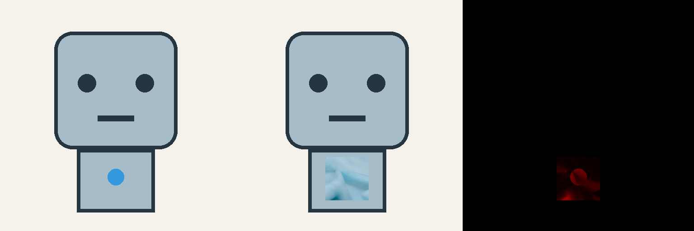

# Validation record

Phase 1 development record. Synthetic tests establish the pixel preservation boundary; they do not establish general character editing quality.

- Automated tests: 19 passed on Python 3.12 (Windows), including independent raster checks and deliberate failures (no-op, ring/center hole, unwanted dot, color error, position shift, Alpha change, permission clipping and review hash mismatch). Published result, validation and review hashes are checked together.
- Generic robot recolor: 1,073 editable pixels changed; zero protected RGBA differences; 512×512 preserved; source SHA256 unchanged.
- Extract: exact 288×276 crop; source unchanged.
- Diffusion backend: real SD1.5 Inpainting inference through local ComfyUI succeeded on RTX 5060 (8 GB), Python 3.12.15, PyTorch 2.10.0+cu128, ComfyUI 0.44.0, pinned source revision recorded in setup. Warm end-to-end request approximately 2.8 seconds; cold first request approximately 7.6 seconds. These are observations, not benchmarks.
- Inpainting removal task: circular indicator removed; 4,225 editable pixels changed; zero protected RGBA differences; 512×512 retained. Visually reviewed at native size. A slight panel-tone transition remains inside the permitted region; not a universal seamlessness guarantee.
- Square replacement task: FAILED visual intent review. Whole-image inference erased the indicator. Context-crop trials produced a ring or a bordered square with an unwanted center mark. A later seed produced an irregular two-color shape. Protected pixels remained exact in all these trials. The pipeline does not mark these candidates accepted or modify defaults based on this result.
- Square replacement task, corrected method: PASSED using explicit deterministic geometry. 33×33 solid red pixels (1,089 total), center `(256,392)` unchanged, exact flat background restored around the square, no center mark or extra colors. 1,185 pixels changed; zero protected RGBA differences. Native and enlarged images visually accepted. Two independent executions produced identical PNG SHA256 `b63762a03af0d33840f990f5441e02ff94726167e1a88eadf61031984e5bb047`. This resolves the original unmet task without claiming that diffusion now creates exact squares.
- Separate synthesis task: PASSED visual review for a light-blue woven textile insert replacing only the declared surface and indicator. Working crop is exactly the 96×96 authorized region, sampled at 512×512; 9,216 native pixels changed and protected RGBA differences are zero. Generated cloth includes folds; these belong to the authorized material replacement. Weave is visible at generation resolution, while the native small patch loses fine thread detail. The square insert boundary is intentional. End-to-end runtime observed around 2.8 seconds on the existing environment.
- Recolor: visually reviewed; only indicator color changed. Extract: crop dimensions and source immutability verified.
- Run reports intentionally retain `intent_review: pending`. Visual review records are separate, hash-bound and append-only. Public generic-artwork records are included as `examples/square-review.json` and `examples/textile-review.json`; the application never silently promotes automatic pixel checks into design approval.

The defined Phase 1 sample tasks now pass: exact extraction, recolor, centered square replacement through the appropriate deterministic method, and local masked material synthesis, with zero protected-pixel differences. This is acceptance of these declared tasks, not a guarantee for arbitrary artwork or unrestricted shape edits. The failed diffusion square attempts remain failed and visible. No ControlNet, SDXL, other generation model or paid API was introduced. Improve operation selection and masks/context before expanding model dependencies.

The model SHA256 and runtime source revision are in [setup](comfyui.md). Runtime API reported approximately 3.2 GiB occupied device VRAM after inference (includes desktop and other allocations); peak process VRAM was not measured and is not claimed.

CI runs the CPU test suite on Windows and Linux with Python 3.11/3.12. GPU tests are manual and must be recorded separately. No private artwork is included.
